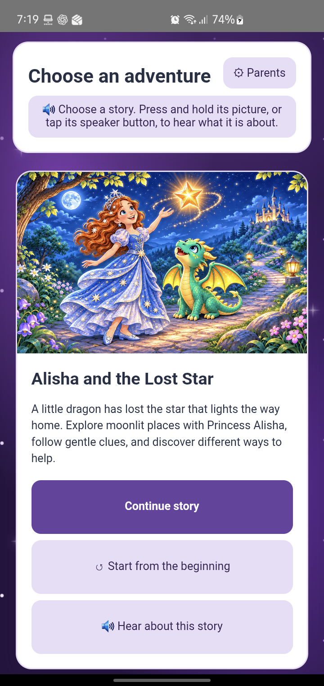

# Alisha's Adventures

**A talking choose-your-own-adventure storybook for young children.** Guide Alisha through a magical journey, listen to each choice, and discover where your story leads.

**English · Spanish · Gujarati · Two princesses · 10 endings · Offline Android play**

## Meet the first story

In **Alisha and the Lost Star**, Alisha and a little green dragon set out along moonlit paths to find a missing star. The choices your child makes change the journey. There are gentle surprises, different routes, and ten endings to discover.

## Take a look

## How children play

- **Pick a story.** Tap its picture to begin, or hold the picture or tap its speaker button to hear what it is about.
- **Listen and read along.** A narrator reads the situation and then the choices. The current words are highlighted on screen.
- **Make the choice.** Tap once to take a path. Hold a choice or tap its speaker button to hear it again.
- **Take your time.** Replay the current screen or ask for a story-aware hint whenever you need one.
- **Come back later.** Continue where you stopped, or start the story again from the beginning.

## For grown-ups

The parent section lets you choose **English, Spanish, or Gujarati** and select either princess. A simple grown-up check protects those settings. On Android, **Keep game open** uses screen pinning to help keep the game in front of your child.

Stories, pictures, and recorded voices are included in the app. **No login or internet connection is needed to play.** Story progress and parent choices are saved on the device.

## Getting the app

The first adventure is playable, and the Android app is still being prepared for a public release. There is no download linked here yet.

## Want to work on the game?

See the [developer setup and project guide](CONTRIBUTING.md).
